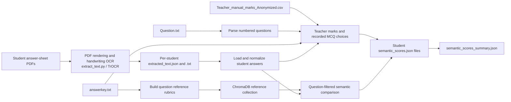

<<<<<<< HEAD
# Handwritten Answer Evaluation

This project extracts handwritten answers from student exam PDFs, compares each response with the exam answer key, and writes a question-by-question score report for each student.

## Architecture



### Processing stages

1. **PDF OCR** — `extract_text.py` renders each PDF page, detects handwritten lines, and uses Microsoft's `microsoft/trocr-base-handwritten` model to recognize the writing. It saves `extracted_text.txt` and `extracted_text.json` under a per-student output directory.
2. **Question and key loading** — `semantic_index.py` reads numbered questions from `dataset/Question.txt` and the correct answers and question types from `dataset/answerkey.txt`.
3. **Reference indexing** — LangChain creates reference documents. MCQ references include the correct option and option text; short-answer references use the answer-key text. The documents are embedded with `sentence-transformers/all-MiniLM-L6-v2` and stored in ChromaDB. At scoring time, the reference lookup is filtered by question number so an answer is compared with that question's rubric.
4. **Scoring** — MCQs receive 1 point for a matching choice and 0 otherwise. Short answers are compared semantically and receive up to 2 points (full credit at similarity ≥ 0.75, partial credit at ≥ 0.45, otherwise 0). When a teacher marks file is present, its recorded MCQ choice is checked against the key and its per-question short-answer marks are used directly.
5. **Reporting** — one `semantic_scores.json` is written per student, with a summary at `outputs/semantic_scores_summary.json`.

## Project layout

```text
dataset/
  Student_Pdf/                       # Input student PDFs
  Question.txt                        # Exam questions and MCQ options
  answerkey.txt                       # Question types and reference answers
  Teacher_manual_marks_Anonymized.csv # Teacher-recorded choices and marks (optional)
outputs/
  ocr/Student_1/                      # OCR text, OCR JSON, and score JSON per student
  ...
  ocr/Student_10/
  chroma_db/                          # Persistent ChromaDB collections
  semantic_scores_summary.json
extract_text.py
semantic_index.py
```

## Per-student output JSON

Each `outputs/ocr/Student_n/semantic_scores.json` contains student totals and one answer record per question. Example:

```json
{
  "student_id": "Student_1",
  "total_score": 33,
  "max_score": 50,
  "answers": [
    {
      "question_number": 1,
      "question_type": "MCQ",
      "question": "Question wording and choices...",
      "student_answer": "B",
      "reference_answer": "B",
      "matches": true,
      "score": 1,
      "max_score": 1,
      "level": "high",
      "reason": "Selected option B matches the answer key."
    }
  ]
}
```

Field meanings:

| Field | Description |
| --- | --- |
| `question_number` | Exam question number. |
| `question_type` | `MCQ` or short-answer type from the key. |
| `question` | Original question text, including choices where applicable. |
| `student_answer` | OCR-extracted response; for students with teacher records, MCQ choice is the teacher-recorded choice. |
| `reference_answer` | Correct answer or rubric text from `answerkey.txt`. |
| `matches` | Whether the response received any credit (`score > 0`). |
| `score` / `max_score` | Awarded points and points available for the question. |
| `level` | `high`, `medium`, or `low`, based on the scoring result. |
| `reason` | Brief explanation of the decision or teacher-awarded marks. |

The top-level `total_score` is the sum of the answer row scores; `max_score` is the sum of available points. The summary JSON lists each student's total and report path.

## Setup and run

Use Python 3.10 or newer. Install the OCR and scoring dependencies:

```bash
pip install torch transformers pymupdf pillow opencv-python numpy
pip install chromadb langchain-chroma langchain-community langchain-core langchain-huggingface sentence-transformers
```

Run OCR over the PDFs (the default input folder is `dataset/Student_Pdf`; output is `outputs/ocr`):

```bash
python extract_text.py
```

Then build the semantic index and score the extracted answers:

```bash
python semantic_index.py
```

The first run may download the TrOCR and sentence-transformer model weights. `semantic_index.py` recreates its `question_rubrics` and `student_answers` ChromaDB collections each run. The `student_answers` collection is persisted as an index of extracted responses; the current scoring decisions use the extracted answer records and the question-filtered reference collection.

## Teacher marks and score interpretation

`dataset/Teacher_manual_marks_Anonymized.csv` is optional. It contains student IDs, aggregate teacher totals, per-question MCQ choices (`Q1`–`Q20`), and short-answer marks (`Q21`–`Q35`). The script uses per-question data: it checks the recorded MCQ choices against the answer key and applies recorded short-answer points directly. It does not use the aggregate total to alter question scores. Therefore, if the supplied choices do not reconcile with the teacher's aggregate MCQ subtotal, the generated total follows the per-question choices and short-answer marks and may differ from that aggregate.

Students without a teacher row are scored from OCR using the MCQ key and the semantic short-answer comparison. Semantic similarity is a scoring aid; handwriting recognition and semantic scores should be reviewed where source scans or OCR text are unclear.

## Notes

- Input files should use the question numbering in `Question.txt` and `answerkey.txt`.
- OCR can miss, merge, or misnumber answers; the reports preserve OCR text when it is available but cannot restore text that OCR did not recognize.
- Keep student PDFs and other personally identifying records out of public repositories unless they have been anonymized and are safe to publish.
=======
# answer_evaluation
>>>>>>> 80523bbd4dadcdac102f177303085ba88cd9135e
